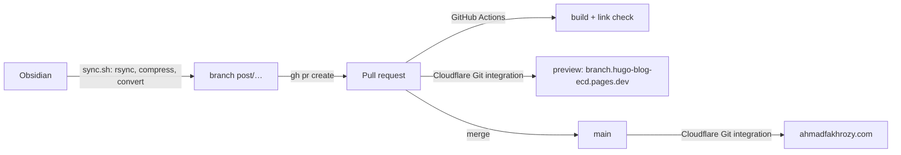

# Hugo Blog Sync

Sync Obsidian posts and images to Hugo, compress images, and open a pull request. GitHub Actions builds and checks it, Cloudflare Pages deploys a preview, and merging to `main` publishes it.

## Quick Start

```bash
./sync.sh
```

Preview changes without creating a branch, commit or PR:

```bash
./sync.sh --dry-run
```

## Workflow



`sync.sh` starts from a clean, up-to-date `main`, waits for the checks, prints the preview URL and asks before merging. Nothing is pushed to `main` directly.

## Configuration

These can be set as environment variables or edited in `sync.sh`:

| Variable | Description | Default |
|----------|-------------|---------|
| `OBSIDIAN_POSTS` | Obsidian posts folder | `/home/ozy/Obsidian/SecondBrain/Posts` |
| `OBSIDIAN_ATTACHMENTS` | Obsidian images folder | `/home/ozy/Obsidian/SecondBrain/attachments` |
| `HUGO_POSTS` | Hugo posts destination | `/home/ozy/git/hugo-blog/content/blog` |
| `HUGO_IMAGES` | Hugo images destination | `/home/ozy/git/hugo-blog/static/images` |
| `MYREPO` | GitHub repository URL | `https://github.com/ozy-ahmad/hugo-blog` |

## Features

- ✅ Syncs posts from Obsidian to Hugo
- ✅ Syncs and compresses images (max 1200px, ~50% smaller)
- ✅ Converts `![[image.png]]` → ``
- ✅ Opens a PR; GitHub Actions builds, checks and Cloudflare deploys a preview
- ✅ Waits for CI, shows the preview, and asks before merging
- ✅ Dry-run mode for previewing changes

## Requirements

- git, rsync, python3, gh (logged in: `gh auth login`)
- python-pillow (auto-installed via pacman)

## Theme Management

This site uses [PaperMod](https://github.com/adityatelange/hugo-PaperMod/) theme as a git submodule.

```bash
# Check current theme version
cd themes/PaperMod && git log -1 --oneline

# Update theme to latest
git submodule update --remote themes/PaperMod

# After updating, check custom layouts for compatibility
# See layouts/README.md for customizations
```

> **Note:** Custom layouts in `layouts/` override theme defaults. After updating the theme, compare your customizations with the new theme files.

