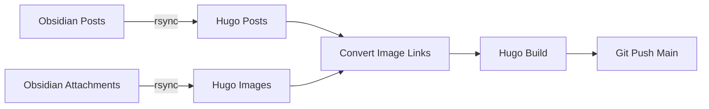

# Hugo Blog Sync

Sync Obsidian posts and images to Hugo, then deploy to GitHub.

## Usage

```bash
./sync.sh
```

## What It Does



## Configuration

| Setting | Path |
|---------|------|
| Obsidian Posts | `/home/ozy/Obsidian/SecondBrain/Posts` |
| Obsidian Attachments | `/home/ozy/Obsidian/SecondBrain/attachments` |
| Hugo Posts | `content/posts` |
| Hugo Images | `static/images` |

## Image Conversion

The script automatically converts Obsidian image syntax to Hugo format:

| Obsidian | Hugo |
|----------|------|
| `![[photo.png]]` | `` |
| `![[photo.png\|My Photo]]` | `` |
