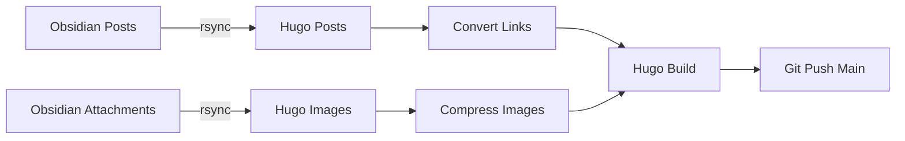

# Hugo Blog Sync

Sync Obsidian posts and images to Hugo, compress images, and deploy to GitHub.

## Quick Start

```bash
./sync.sh
```

Preview changes without committing:

```bash
./sync.sh --dry-run
```

## Workflow



## Configuration

These can be set as environment variables or edited in `sync.sh`:

| Variable | Description | Default |
|----------|-------------|---------|
| `OBSIDIAN_POSTS` | Obsidian posts folder | `/home/ozy/Obsidian/SecondBrain/Posts` |
| `OBSIDIAN_ATTACHMENTS` | Obsidian images folder | `/home/ozy/Obsidian/SecondBrain/attachments` |
| `HUGO_POSTS` | Hugo posts destination | `/home/ozy/git/hugo-blog/content/blog` |
| `HUGO_IMAGES` | Hugo images destination | `/home/ozy/git/hugo-blog/static/images` |
| `MYREPO` | GitHub repository URL | `https://github.com/ozy-ahmad/hugo-blog` |
| `BRANCH` | Git branch to push | `main` |

## Features

- ✅ Syncs posts from Obsidian to Hugo
- ✅ Syncs and compresses images (max 1200px, ~50% smaller)
- ✅ Converts `![[image.png]]` → ``
- ✅ Builds Hugo site
- ✅ Commits and pushes to GitHub
- ✅ Dry-run mode for previewing changes

## Requirements

- git, rsync, python3, hugo
- python-pillow (auto-installed via pacman)

## Theme Management

This site uses [PaperMod](https://github.com/adityatelange/hugo-PaperMod/) theme as a git submodule.

```bash
# Check current theme version
cd themes/PaperMod && git log -1 --oneline

# Update theme to latest
git submodule update --remote themes/PaperMod

# After updating, check custom layouts for compatibility
# See layouts/README.md for customizations
```

> **Note:** Custom layouts in `layouts/` override theme defaults. After updating the theme, compare your customizations with the new theme files.

