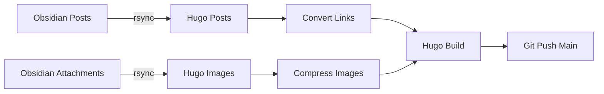

---
title: "Moving my personal website to Hugo"
date: 2025-12-18
publish: true
draft: false
tags: ["hugo", "personal site"]
categories: ["blog"]
summary: "Using HUGO to deploy my personal note from obsidian (a markdown note app)"

---

## Introduction

I've been wanting to document my projects, my work, and the new things I learn by turning them into blog posts or shared personal notes. While I already have a lot of projects documented in my personal notes, I haven't published much since I posted on Medium a couple of years ago. 

I believe that sharing my personal projects and fun learning experiences will help improve my writing skills. In this blog post, I will show you how to turn your personal notes directly into published blog posts.

## Tools that I use

Over the years, I've used a variety of note-taking apps like Notion, Evernote, and Apple Notes. Recently, I switched to *Obsidian*, a markdown-based note app. It was easy to pick up since I already use Markdown for most of my personal and work projects. 

My goal is to treat my notes as my "Second Brain." I use the PARA method by Tiago Forte to organize my notes in Obsidian, which makes it incredibly easy to push them straight to my personal blog (ahmadfakhrozy.com). 

To make the blog work, I use Hugo. Hugo is an open-source static site generator that easily converts Markdown into static HTML files. Plus, there are tons of great templates built by the community that you can use right out of the box.

## Workflow



My workflow starts with my posts and attachments in Obsidian. The script syncs them to the Hugo directory, converts the image links, and compresses the images. Then, it builds the site and pushes it to GitHub, where an automated CI pipeline publishes the static site via Netlify.

Everything is handled by a single Python sync script that I created. I will include the full script at the end of this post!

During my research, I noticed that NetworkChuck built a very similar automated Hugo pipeline. If you want a more detailed guide on setting up Hugo from scratch, I highly recommend checking out his article: [My Insane Blog Pipeline](https://blog.networkchuck.com/posts/my-insane-blog-pipeline/).


``` bash
#!/bin/bash
set -euo pipefail

# Change to the script's directory (hugo-blog root)
SCRIPT_DIR="$(cd "$(dirname "${BASH_SOURCE[0]}")" && pwd)"
cd "$SCRIPT_DIR"

# =============================================================================
# Script Options
# =============================================================================

DRY_RUN=false
BRANCH="${BRANCH:-main}"

# Parse command line arguments
while [[ $# -gt 0 ]]; do
    case $1 in
        --dry-run|-n)
            DRY_RUN=true
            echo "🏃 Dry-run mode enabled - no changes will be committed or pushed"
            shift
            ;;
        --help|-h)
            echo "Usage: ./sync.sh [OPTIONS]"
            echo ""
            echo "Options:"
            echo "  --dry-run, -n    Preview changes without committing or pushing"
            echo "  --help, -h       Show this help message"
            echo ""
            echo "Environment Variables:"
            echo "  OBSIDIAN_POSTS        Path to Obsidian posts folder"
            echo "  OBSIDIAN_ATTACHMENTS  Path to Obsidian attachments folder"
            echo "  HUGO_POSTS            Path to Hugo posts destination"
            echo "  HUGO_IMAGES           Path to Hugo images destination"
            echo "  MYREPO                GitHub repository URL"
            echo "  BRANCH                Git branch to push (default: main)"
            exit 0
            ;;
        *)
            echo "Unknown option: $1"
            echo "Use --help for usage information"
            exit 1
            ;;
    esac
done

# =============================================================================
# Configuration (can be overridden via environment variables)
# edit the variable base of your directory and repo =============================================================================

# Obsidian paths
OBSIDIAN_POSTS="${OBSIDIAN_POSTS:-...}"
OBSIDIAN_ATTACHMENTS="${OBSIDIAN_ATTACHMENTS:-.....}"

# Hugo paths
HUGO_POSTS="${HUGO_POSTS:-...}"
HUGO_IMAGES="${HUGO_IMAGES:-...}"

# GitHub repo
MYREPO="${MYREPO:-...}"

# =============================================================================
# Pre-flight checks
# =============================================================================

echo "🔍 Checking required commands..."
for cmd in git rsync python3 hugo; do
    if ! command -v $cmd &> /dev/null; then
        echo "❌ $cmd is not installed or not in PATH."
        exit 1
    fi
done
echo "✅ All required commands available."

# Check and install Pillow for image compression
echo "🐍 Checking Python dependencies..."
if ! python3 -c "from PIL import Image" 2>/dev/null; then
    echo "📦 Installing Pillow for image compression..."
    echo "   Run: sudo pacman -S python-pillow"
    sudo pacman -S --noconfirm python-pillow
    echo "✅ Pillow installed."
else
    echo "✅ Pillow already installed."
fi

# =============================================================================
# Step 1: Initialize Git if needed
# =============================================================================

if [ ! -d ".git" ]; then
    echo "📁 Initializing Git repository..."
    git init
    git remote add origin $MYREPO
else
    echo "✅ Git repository already initialized."
    if ! git remote | grep -q 'origin'; then
        echo "🔗 Adding remote origin..."
        git remote add origin $MYREPO
    fi
fi

# =============================================================================
# Step 2: Sync posts from Obsidian to Hugo
# =============================================================================

echo "📝 Syncing posts from Obsidian..."

if [ ! -d "$OBSIDIAN_POSTS" ]; then
    echo "❌ Source path does not exist: $OBSIDIAN_POSTS"
    exit 1
fi

if [ ! -d "$HUGO_POSTS" ]; then
    echo "📁 Creating destination path: $HUGO_POSTS"
    mkdir -p "$HUGO_POSTS"
fi

# Sync posts (trailing slash on source copies contents, not the folder itself)
rsync -av --delete "$OBSIDIAN_POSTS/" "$HUGO_POSTS/"
echo "✅ Posts synced."

# =============================================================================
# Step 3: Sync attachments/images from Obsidian to Hugo
# =============================================================================

echo "🖼️  Syncing images from Obsidian..."

if [ ! -d "$OBSIDIAN_ATTACHMENTS" ]; then
    echo "⚠️  Attachments path does not exist: $OBSIDIAN_ATTACHMENTS"
    echo "   Skipping image sync..."
else
    if [ ! -d "$HUGO_IMAGES" ]; then
        echo "📁 Creating images directory: $HUGO_IMAGES"
        mkdir -p "$HUGO_IMAGES"
    fi
    
    rsync -av --delete "$OBSIDIAN_ATTACHMENTS/" "$HUGO_IMAGES/"
    echo "✅ Images synced."
fi

# =============================================================================
# Step 4: Compress images and convert Obsidian image links
# =============================================================================

echo "🔄 Processing and compressing images..."

python3 << 'PYTHON_SCRIPT'
"""
1. Compress images in static/images (PNG/JPG)
2. Convert Obsidian image links to Hugo format
"""
import os
import re
from pathlib import Path

# Try to import Pillow for image compression
try:
    from PIL import Image
    PILLOW_AVAILABLE = True
except ImportError:
    PILLOW_AVAILABLE = False
    print("⚠️  Pillow not installed. Skipping image compression.")
    print("   Install with: pip install Pillow")

# =============================================================================
# Image Compression
# =============================================================================

def compress_images(images_dir, max_width=1200, quality=85):
    """Compress images to reduce file size."""
    if not PILLOW_AVAILABLE:
        return
    
    images_path = Path(images_dir)
    if not images_path.exists():
        return
    
    image_extensions = {'.png', '.jpg', '.jpeg', '.webp'}
    image_files = [f for f in images_path.iterdir() 
                   if f.suffix.lower() in image_extensions]
    
    if not image_files:
        print("No images to compress.")
        return
    
    print(f"Compressing {len(image_files)} image(s)...")
    
    for img_path in image_files:
        try:
            original_size = img_path.stat().st_size
            
            with Image.open(img_path) as img:
                # Convert RGBA to RGB for JPEG (remove alpha channel)
                if img.mode == 'RGBA' and img_path.suffix.lower() in {'.jpg', '.jpeg'}:
                    img = img.convert('RGB')
                
                # Resize if wider than max_width
                if img.width > max_width:
                    ratio = max_width / img.width
                    new_height = int(img.height * ratio)
                    img = img.resize((max_width, new_height), Image.Resampling.LANCZOS)
                
                # Save with compression
                if img_path.suffix.lower() == '.png':
                    img.save(img_path, 'PNG', optimize=True)
                elif img_path.suffix.lower() in {'.jpg', '.jpeg'}:
                    img.save(img_path, 'JPEG', quality=quality, optimize=True)
                elif img_path.suffix.lower() == '.webp':
                    img.save(img_path, 'WEBP', quality=quality)
            
            new_size = img_path.stat().st_size
            savings = ((original_size - new_size) / original_size) * 100
            
            if savings > 0:
                print(f"  ✅ {img_path.name}: {original_size//1024}KB → {new_size//1024}KB ({savings:.1f}% smaller)")
            else:
                print(f"  ℹ️  {img_path.name}: already optimized")
                
        except Exception as e:
            print(f"  ❌ Error compressing {img_path.name}: {e}")

# =============================================================================
# Convert Obsidian Image Links
# =============================================================================

def convert_obsidian_images(content):
    import urllib.parse
    pattern = r'!\[\[([^\]|]+)(?:\|([^\]]+))?\]\]'
    
    def replace_image(match):
        filepath = match.group(1).strip()
        alt_text = match.group(2)
        filename = os.path.basename(filepath)
        alt = alt_text.strip() if alt_text else os.path.splitext(filename)[0]
        # URL-encode the filename to handle spaces and special characters
        encoded_filename = urllib.parse.quote(filename)
        return f''
    
    return re.sub(pattern, replace_image, content)

# =============================================================================
# Main
# =============================================================================

# Compress images
compress_images('/home/ozy/git/hugo-blog/static/images')

# Process markdown files
posts_dir = Path('/home/ozy/git/hugo-blog/content/blog')
md_files = list(posts_dir.glob('**/*.md'))

print(f"\nProcessing {len(md_files)} markdown file(s)...")

for md_file in md_files:
    try:
        content = md_file.read_text(encoding='utf-8')
        if '![[' in content:
            new_content = convert_obsidian_images(content)
            if content != new_content:
                md_file.write_text(new_content, encoding='utf-8')
                print(f"  ✅ Converted links: {md_file.name}")
            else:
                print(f"  ℹ️  No changes: {md_file.name}")
        else:
            print(f"  ⏭️  Skipped: {md_file.name}")
    except Exception as e:
        print(f"  ❌ Error: {md_file.name}: {e}")

print("Done.")
PYTHON_SCRIPT

echo "✅ Images processed."

# =============================================================================
# Step 5: Build the Hugo site
# =============================================================================

echo "🏗️  Building the Hugo site..."
if ! hugo; then
    echo "❌ Hugo build failed."
    exit 1
fi
echo "✅ Hugo site built."

# =============================================================================
# Step 6: Stage changes for Git
# =============================================================================

echo "📦 Staging changes for Git..."
if git diff --quiet && git diff --cached --quiet; then
    echo "ℹ️  No changes to stage."
else
    if [ "$DRY_RUN" = true ]; then
        echo "🔍 [DRY-RUN] Would stage changes:"
        git status --short
    else
        git add .
        echo "✅ Changes staged."
    fi
fi

# =============================================================================
# Step 7: Commit changes
# =============================================================================

commit_message="New Blog Post on $(date +'%Y-%m-%d %H:%M:%S')"
if [ "$DRY_RUN" = true ]; then
    if ! git diff --quiet; then
        echo "🔍 [DRY-RUN] Would commit with message: $commit_message"
    fi
elif git diff --cached --quiet; then
    echo "ℹ️  No changes to commit."
else
    echo "💾 Committing changes..."
    git commit -m "$commit_message"
    echo "✅ Changes committed."
fi

# =============================================================================
# Step 8: Push to branch
# =============================================================================

if [ "$DRY_RUN" = true ]; then
    echo "🔍 [DRY-RUN] Would push to $BRANCH branch"
else
    echo "🚀 Deploying to GitHub ($BRANCH)..."
    if ! git push origin "$BRANCH"; then
        echo "❌ Failed to push to $BRANCH branch."
        exit 1
    fi
    echo "✅ Pushed to $BRANCH branch."
fi

# =============================================================================
# Done!
# =============================================================================

echo ""
if [ "$DRY_RUN" = true ]; then
    echo "🏁 Dry-run complete! No changes were committed or pushed."
else
    echo "🎉 All done! Site synced, processed, committed, built, and pushed to $BRANCH."
fi


```


